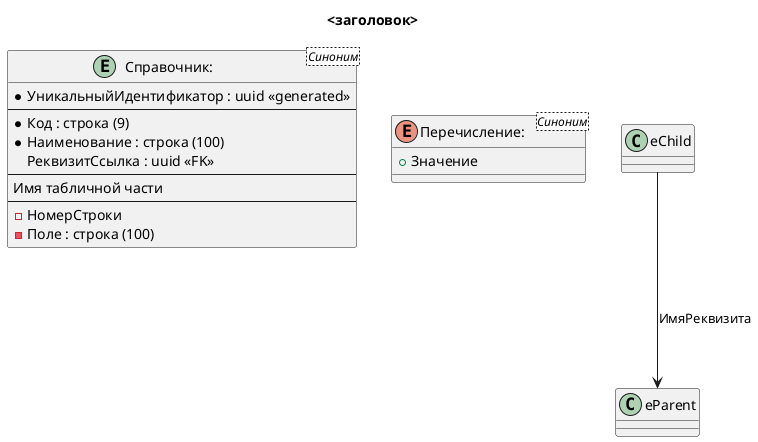

# PlantUML в документации PSSL

Диаграмма документации — пара файлов. Исходник правится вручную, картинка появляется после push.

## Куда класть

1. Исходник: `docs/puml/<Имя>.puml`. Имя файла — латиница, как у уже лежащих схем.
2. В странице из каталога `docs/` только ссылка, тем же именем:

```markdown

```

3. Не вставлять `@startuml` и блок PlantUML в Markdown. Workflow читает и `.puml`, и Markdown; исходник в странице даст лишний SVG.
4. Не рисовать SVG, не вызывать PlantUML локально и не коммитить `docs/images/*.svg`. После push workflow `.github/workflows/generate-puml-svg.yml` пишет SVG в `docs/images` и коммитит его с сообщением `Render PlantUML files`. В локальном клоне картинки нет, пока этот коммит не подтянут.

## Какой образец открыть

Перед новой или правленной схемой прочитать ближайший существующий файл и повторить его приёмы. Новый стиль не вводить.

| Схема | Образец |
|---|---|
| ER подсистемы: справочники, перечисления, внешние ключи, табличные части | `docs/puml/ERArchitectureIntegrationsSubsystem.puml` |
| Объектная модель классов платформы | `docs/puml/ОбъектнаяМодельСхемаЗапроса.puml` |

Реквизиты, связи и предопределённые элементы брать из метаданных конфигурации. Не переносить поля из памяти и не копировать чужую подсистему «для примера».

## ER подсистемы

Каркас. Полный образец — файл из таблицы, включая стрелки и страницу примечания.



- Обязательное поле начинается с `*`.
- Тип писать по-русски, как в образце: `строка (100)`, `булево`, `uuid <<generated>>`, `uuid <<FK>>`.
- Табличная часть — отдельный отсек между `--`, поля с ведущим `-`.
- Подпись связи — имя реквизита. Иерархия групп и элементов: `alias <- alias : Родитель`.
- Связь без ссылки метаданных (хранилище, перечень предопределённых) — пунктир, как в образце ER.
