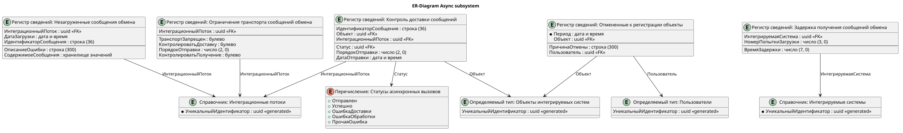

# Подсистема "Асинхронные интеграции"

## Общие сведения

Подсистема обеспечивает обмен объектами конфигурации через шину и брокеры. Она формирует исходящие сообщения, загружает входящие сообщения, сопоставляет поля, управляет повторными попытками и хранит сведения о сообщениях, которые не удалось загрузить. В конфигурации подсистема называется **АсинхронныеИнтеграции** и входит в подсистему **пбп_УправлениеИнтеграциями**.

Подсистема содержит программный интерфейс и объекты, позволяющие удобно и оптимально реагировать на события, являющиеся триггером для обмена, конвертировать и обрабатывать данные сообщений обмена и хранить информацию на каждом этапе. Некоторые методы заточены под конкретные шины (в данном случае, подсистема разрабатывалась под интеграции через шину Datareon ESB), но, по-большей части, подсистема универсальна. Например, модули пбп_ИнтеграцииИсходящие и пбп_ИнтеграцииВходящие включают методы, которые являются обработчиками, вызываемыми из Datareon ESB, но это не значит, что механизм конвертации, с которым оперируют обработчики, являются заточенными конкретно под эту шину. Его можно использовать для конвертации любых сообщений обмена асинхронных интеграций, так как конвертация является заменой конвертации данных 3.0: без привязки к объекту XDTO и без инициализации правил обмена для всех объектов - правила обмена инициализируются под конкретный объект, который выгружается/загружается в данный момент, что ускоряет обработку данных.

Использование механизма управляется функциональной опцией **пбп_ИспользоватьУправлениеАсинхроннымиИнтеграциями**. Ее значение хранится в одноименной константе типа булево. Опция включает обработку настроек обмена и четыре регистра подсистемы. В состав подсистемы АсинхронныеИнтеграции опция и константа не входят. Чтение константы закрыто ролью **пбп_ЧтениеКонстантыИспользоватьУправлениеАсинхроннымиИнтеграциями**.

## Состав подсистемы



1. Регистры сведений
    - **пбп_НезагруженныеСообщенияОбмена** — хранит идентификатор и содержимое сообщения, интеграционный поток, дату загрузки и описание ошибки;
    - **пбп_ЗадержкаПолученияСообщенийОбмена** — задает время задержки по интегрируемой системе и номеру попытки;
    - **пбп_ОграниченияТранспортаСообщенийОбмена** — хранит запрет транспорта, порядок отправки и признаки контроля доставки и получения в разрезе интеграционного потока;
    - **пбп_ОтмененныеКРегистрацииОбъекты** — фиксирует объект, причину отмены регистрации и пользователя.

2. Обработки
    - **пбп_УправлениеНастройкамиОбменаЧерезШину** — предоставляет форму настройки обмена и команду **ОткрытьНастройкиОбменаЧерезШину**.

3. Общие модули
    - **пбп_ИнтеграцииВходящие** — обработчики входящих сообщений и настройки универсальной загрузки;
    - **пбп_ИнтеграцииИсходящие** — обработчики формирования исходящих сообщений;
    - **пбп_ИнтеграцииШина** — универсальная выгрузка, загрузка, поиск и сопоставление полей;
    - **пбп_ИнтеграцииШинаПовтИсп** — кэшируемые параметры обмена и карты обработчиков;
    - **пбп_ПереопределениеРегистрацииОбработчиковDatareon** — точки встраивания для отмены и ручной регистрации исходящего сообщения. Модуль заточен под очередь Datareon ESB: это частный случай. Конвертация сообщения и его хранение от этой очереди не зависят.

## Ролевая модель

Для работы с настройками предусмотрены роли **пбп_ЧтениеНастроекОбменаЧерезШину** и **пбп_РедактированиеНастроекОбменаЧерезШину**.

Для регистров подсистемы предусмотрены отдельные роли чтения и редактирования:

- **пбп_ЧтениеЗадержкиПолученияСообщенийОбмена**, **пбп_РедактированиеЗадержкиПолученияСообщенийОбмена**;
- **пбп_ЧтениеНезагруженныхСообщенийОбмена**, **пбп_РедактированиеНезагруженныхСообщенийОбмена**;
- **пбп_ЧтениеОграниченийТранспортаСообщенийОбмена**, **пбп_РедактированиеОграниченийТранспортаСообщенийОбмена**;
- **пбп_ЧтениеОтмененныхКРегистрацииОбъектов**, **пбп_РедактированиеОтмененныхКРегистрацииОбъектов**.

## Порядок взаимодействия

### Настройка

1. Включить константу **пбп_ИспользоватьУправлениеАсинхроннымиИнтеграциями**;
2. Открыть обработку **пбп_УправлениеНастройкамиОбменаЧерезШину** командой **ОткрытьНастройкиОбменаЧерезШину**;
3. Настроить ограничения транспорта для интеграционных потоков: запрет отправки и получения, контроль доставки, контроль получения и порядок отправки;
4. В конфигурации-потребителе заполнить точки встраивания модуля **пбп_ПереопределениеРегистрацииОбработчиковDatareon**, если исходящее сообщение не должно попадать в очередь. Модуль — частный случай шины Datareon ESB. Конвертация и запись истории сообщения универсальны: их выполняют **пбп_ИнтеграцииИсходящие** и **пбп_ИнтеграцииШина**.

### Исходящий обмен

1. Обработчик объекта либо точка встраивания помещает ссылку в очередь исходящих сообщений;
2. Модуль **пбп_ИнтеграцииИсходящие** формирует состав полей и вызывает **пбп_ИнтеграцииШина.ВыгрузитьВПлатформу**;
3. Результат сериализуется в JSON и передается обработчику шины или брокера. Для Datareon ESB это обработчик очереди шины. Запись результата в историю интеграции от конкретной шины не зависит.

### Входящий обмен

1. Событие обмена вызывает экспортную процедуру модуля **пбп_ИнтеграцииВходящие**. В частности, для интеграции через шину Datareon ESB передается текст сообщения, источник, идентификатор, состояние, параметры повторной обработки и текст ошибки;
2. Сообщение преобразуется в XDTO, после чего создаются параметры обмена и параметры сообщения;
3. **пбп_ИнтеграцииШина.ЗагрузитьИзПлатформы** ищет или создает объект, заполняет его и записывает результат;
4. При необходимости задержка и текст ошибки возвращаются вызывающему механизму. Необработанные сообщения могут сохраняться в **пбп_НезагруженныеСообщенияОбмена**. Запись в этот регистр должна происходить при отмене загрузки, в начале метода, до инициализации структуры записи истории интеграции. Таким образом мы логически разделяем те сообщения, которые должны грузиться, но не смогли, в случае ошибки, и те сообщения, которые не должны были загружаться - они и пишутся в этот регистр.

## Программный интерфейс

### пбп_ИнтеграцииШина

- **ИнициализироватьСтруктуруЗаписиИсторииИнтеграции(Поток, СообщениеСтрокой, ЭтоВходящийПоток, ГенерироватьПротокол, ЗаписыватьДанныеСообщения)** возвращает структуру истории интеграции.
- **ЗаписатьРезультатВИсториюИнтеграции(СтруктураИстории, ТекстОшибки, РезультатОбработки, ЭтоВходящийПоток)** записывает результат обработки.
- **ВыгрузитьВПлатформу(ОбъектОбработки, СоставПолей, Узел, СтруктураИсторииИнтеграции)** возвращает структуру данных объекта.
- **ИнициализироватьПараметрыОбмена(...)** и **ИнициализироватьПараметрыСообщения(...)** возвращают структуры, используемые загрузкой.
- **ЗагрузитьИзПлатформы(ПараметрыОбмена, ПараметрыСообщения)** возвращает записанную ссылку либо `Неопределено`, если обработка отложена из-за блокировки.
- **ПолучитьОбъектОбработкиСБлокировкойИдентификатора**, **НайтиПоИдентификаторуПолямПоиска**, **ПолучитьСсылочныйЭлемент** и **ЗаписатьСсылочныйЭлемент** обеспечивают поиск, блокировку и запись объекта.
- Конструкторы **КонструкторСоставаПолей**, **КонструкторПолейСТипом** и **КонструкторСоответствияПолейИсточникаИПриемника**, а также процедуры `Добавить*` и `Дополнить*` формируют описания выгрузки, загрузки и поиска.
- **ИмяПоляПоискаПоВнешнемуИдентификатору()** и **ИмяПоляПоискаПоВнутреннемуИдентификатору()** возвращают имена служебных полей поиска.
- **УзелИнтеграцииПоИсточнику(Источник)** возвращает узел плана обмена или интегрируемую систему.

### пбп_ИнтеграцииШинаПовтИсп

Модуль возвращает кэшируемые сведения: часовой пояс базы, описание регистра публичных идентификаторов, наличие регистра БСП, полное имя плана обмена и карты методов для состава полей, сопоставления, поиска, типов, постобработки и имени реквизита выгрузки.

### пбп_ПереопределениеРегистрацииОбработчиковDatareon

Это переопределяемый модуль внедрения для шины Datareon ESB: частный случай постановки и отмены исходящего сообщения в ее очереди. В нем заполняют точки отмены регистрации для справочника, документа, регистра сведений, регистра накопления и задачи, а также точки ручной регистрации для справочника, документа, регистра накопления и задачи. Конвертация полей и хранение истории сообщения здесь не выполняются: это делают **пбп_ИнтеграцииШина** и регистры подсистемы, и они не привязаны к Datareon.

Методы **ОтменитьРегистрациюОбъекта(Источник, ПричинаОтмены)**, **ПоместитьСообщениеВОчередьИсходящихСообщений(ИмяОбъекта, СсылкаНаОбъект)** и **ЗаписатьОбъектКакОтмененныйКРегистрацииПриНеобходимости(Источник)** реализуют общую часть этих сценариев.

## Примеры вызова

### Настройка транспорта

Обработка **пбп_УправлениеНастройкамиОбменаЧерезШину** открывается командой **ОткрытьНастройкиОбменаЧерезШину**. Перед этим должна быть включена функциональная опция **пбп_ИспользоватьУправлениеАсинхроннымиИнтеграциями**. Ограничения транспорта и задержка получения хранятся в регистрах подсистемы и не привязаны к конкретной шине. Datareon ESB — частный случай потребителя этих настроек.

На странице транспорта выводится дерево интегрируемых систем и их интеграционных потоков. Запись меняется только в строке, где заполнен интеграционный поток: правка флагов и порядка отправки сразу вызывает **пбп_ИнтеграцииСервер.СоздатьИзменитьОграниченияТранспортаСообщенийОбмена**. Команда обновления перечитывает дерево. Изменение доступно при праве изменения регистра **пбп_ОграниченияТранспортаСообщенийОбмена**.

В строке потока задаются:

- **ТранспортЗапрещен** — отправка сообщения по потоку отменяется;
- **КонтролироватьДоставку** — ожидается квитанция о доставке;
- **ПорядокОтправки** — последовательность отправки;
- **КонтролироватьПолучение** — сообщение может быть возвращено в очередь.

Тот же набор записывается из кода:

```bsl
ИнтеграционныйПоток = пбп_ИнтеграцииСлужебный.ИнтеграционныйПоток("ОтправкаИнтеграционногоПотока");

пбп_ИнтеграцииСервер.СоздатьИзменитьОграниченияТранспортаСообщенийОбмена(
	ИнтеграционныйПоток,
	Ложь,
	Истина,
	1,
	Ложь);

Ограничения = пбп_ИнтеграцииСервер.ПолучитьОграниченияТранспортаПоИнтеграционномуПотоку(ИнтеграционныйПоток);
```

**ПолучитьОграниченияТранспортаПоИнтеграционномуПотоку** принимает ссылку потока или идентификатор настройки и возвращает структуру полей регистра. Если записей нет, возвращается `Неопределено`.

### Отмена регистрации исходящего сообщения

Точки встраивания лежат в **пбп_ПереопределениеРегистрацииОбработчиковDatareon**. Это частный случай шины Datareon ESB. Процедуры `ОтменитьРегистрацию*ПриНеобходимости` сами отмену не выполняют: в обработчике перед записью нужно вызвать **ОтменитьРегистрациюОбъекта**, а в обработчике после записи — **ЗаписатьОбъектКакОтмененныйКРегистрацииПриНеобходимости**.

**ОтменитьРегистрациюОбъекта** ставит объекту или набору записей дополнительное свойство `сшпНеОбрабатывать`. Его читает очередь Datareon, чтобы не регистрировать сообщение. Если передана причина, рядом записывается `пбп_ПричинаОтменыРегистрации`. Второй вызов имеет смысл для справочника, документа и задачи: при наличии причины он добавляет ссылку в **пбп_ОтмененныеКРегистрацииОбъекты**. Этот регистр хранит факт отмены независимо от шины. Для набора записей регистра причина в него не пишется.

```bsl
Процедура ОтменитьРегистрациюСправочникаПриНеобходимости(Источник, Отказ) Экспорт

	Если Источник.ОбменДанными.Загрузка Тогда
		Возврат;
	КонецЕсли;

	// Условие конфигурации-потребителя: объект не должен уходить в очередь.
	// Текст причины — пример для Datareon ESB. Свойство сшпНеОбрабатывать читает очередь этой шины.
	пбп_ПереопределениеРегистрацииОбработчиковDatareon.ОтменитьРегистрациюОбъекта(
		Источник, "Объект не должен передаваться в Datareon");

КонецПроцедуры
```

В `ПриЗаписи` того же объекта вызывается вторая процедура. Без нее причина отмены в регистр не попадет:

```bsl
пбп_ПереопределениеРегистрацииОбработчиковDatareon.ЗаписатьОбъектКакОтмененныйКРегистрацииПриНеобходимости(Источник);
```

Для документа, регистра сведений, регистра накопления и задачи заполняются одноименные процедуры модуля. Ручная постановка в очередь Datareon ESB выполняется, если в конфигурации есть общий модуль `сшпПользовательскиеМетоды`. Для другой шины этот вызов не используется: сообщение ставится в ее собственную очередь, а конвертация по-прежнему идет через **пбп_ИнтеграцииШина**. Дело в том, что
поставляемая вендором Datareon ESB работает следующим образом: при записи вызывается подписка на событие, которая без условно регистрирует объект интеграции к обмену, если он есть в составе обменов, а он, в свою очередь, настраивается в шине. Отмена регистрации происходит по флагу в дополнительных свойствах объекта, чем и можно манипулировать, для создания условий регистрации объекта.
```bsl
пбп_ПереопределениеРегистрацииОбработчиковDatareon.ПоместитьСообщениеВОчередьИсходящихСообщений(
	"Справочник.Номенклатура", СсылкаНаОбъект);
```

### Задержка получения сообщений

На второй странице той же обработки задается время ожидания перед повторной загрузкой, в секундах, по номеру попытки. Число строк определяется предопределенным значением **МаксимальноеКоличествоПопытокЗагрузкиИзШины**.

Тип настройки «На все системы» записывает одну таблицу всем непомеченным на удаление интегрируемым системам и заменяет ранее заданные значения по системам. Тип «По системе» пишет набор только выбранной системы; без выбранной системы сохранение не выполняется. Нулевое время задержки в набор не попадает: такая попытка при записи удаляется. Сохранение требует права изменения регистра **пбп_ЗадержкаПолученияСообщенийОбмена**.

Чтение из кода идет через **пбп_ИнтеграцииСервер.ПолучитьЗадержкуПолученияСообщенийОбмена**. Без номера попытки функция возвращает таблицу. С номером попытки возвращает структуру одной записи, а если записи нет — пустую таблицу.

```bsl
ИнтегрируемаяСистема = пбп_ИнтеграцииСервер.ИнтегрируемаяСистема(Источник);
НомерПопытки = КоличествоПопытокОжидания + 1;
ЗаписьЗадержки = пбп_ИнтеграцииСервер.ПолучитьЗадержкуПолученияСообщенийОбмена(
	ИнтегрируемаяСистема, НомерПопытки);

Если ТипЗнч(ЗаписьЗадержки) = Тип("Структура") Тогда
	Задержка = ЗаписьЗадержки.ВремяЗадержки;
КонецЕсли;
```

Параметр `Задержка` после вызова читает тот, кто вызвал входящий обработчик: шина или брокер. Для Datareon ESB это сама шина. Пока задержка больше нуля, сообщение остается во входящей очереди. При блокировке объекта загрузка сама ставит задержку 30 секунд и возвращает признак повтора. Этот интервал из регистра не берется. Запись задержки в **пбп_ЗадержкаПолученияСообщенийОбмена** от конкретной шины не зависит.

### Незагруженные сообщения обмена

Регистр **пбп_НезагруженныеСообщенияОбмена** загрузка сама не заполняет. Запись делает вызывающий код, когда сообщение отклонено и его нужно сохранить вместе с текстом ошибки. Обязательны интеграционный поток и дата загрузки. Идентификатор сообщения входит в ключ записи. Содержимое передается хранилищем значения.

```bsl
ПараметрыЗаписи = Новый Структура;
ПараметрыЗаписи.Вставить("ИнтеграционныйПоток", СтруктураИстории.ИнтеграционныйПоток);
ПараметрыЗаписи.Вставить("ДатаЗагрузки", ТекущаяДатаСеанса());
ПараметрыЗаписи.Вставить("ИдентификаторСообщения", Идентификатор);
ПараметрыЗаписи.Вставить("ОписаниеОшибки", ТекстОшибки);
ПараметрыЗаписи.Вставить("СодержимоеСообщения", Новый ХранилищеЗначения(СообщениеОбмена));

РегистрыСведений.пбп_НезагруженныеСообщенияОбмена.ДобавитьЗапись(ПараметрыЗаписи);
```

**ДобавитьЗапись** вызывает исключение, если параметр не структура, поток пустой или дата загрузки пустая. **ИзменитьЗапись** ищет существующую запись по потоку, дате и идентификатору и меняет ресурсы. **УдалитьЗаписи** очищает набор по заполненным измерениям ключа; без хотя бы одного измерения вызывает исключение.

### Исходящий обработчик

Новая выгрузка — экспортная процедура модуля **пбп_ИнтеграцииИсходящие**. Ее имя указывается в шине или у брокера для типа сообщения. Готовые процедуры модуля — **Справочник_пбп_НастройкиИнтеграции** и **Справочник_пбп_ИнтеграционныеПотоки**. Значение они не возвращают: текст сообщения пишется в `РезультатОбработки`, ошибка — в `ТекстОшибки`. Вместе с ними в процедуру приходят объект обработки, состояние сообщения, тип объекта, метод хранения, задержка, формат, дата регистрации, ссылка и массив дополнительных функций. Этот набор — контракт вызова из Datareon ESB, частный случай. Правила конвертации, которые процедура передает в **ВыгрузитьВПлатформу**, от шины не зависят: ими описывается конкретное асинхронное сообщение. Строка потока должна находиться как идентификатор настройки справочника **пбп_ИнтеграционныеПотоки**: по ней создается запись истории.

Правила конвертации собирает **КонструкторСоставаПолей**. Поля объекта — массив **КонструкторПолейСТипом**. Каждое поле добавляется **ДополнитьПоляПолемСТипом**:

- первое значение — путь реквизита приемника, в том числе через точку (`Родитель.ИдентификаторНастройки`);
- второе — ключ поля в сообщении (`parent`);
- признак публичного идентификатора ставится для ссылки, которую нужно выгрузить внешним идентификатором, а не уникальным идентификатором ссылки.

Табличная часть добавляется отдельно: **ДобавитьПоляТабличнойЧастиВСоставПолей**. Последний параметр — ключ массива в сообщении. Готовый состав передается в **ВыгрузитьВПлатформу**, результат сериализуется в JSON и пишется в `РезультатОбработки`.

```bsl
Функция ПоляВыгрузки_Справочник_пбп_ИнтеграционныеПотоки()

	Результат = пбп_ИнтеграцииШина.КонструкторСоставаПолей();

	Поля = пбп_ИнтеграцииШина.КонструкторПолейСТипом();
	пбп_ИнтеграцииШина.ДополнитьПоляПолемСТипом(Поля, "Ссылка", "ref");
	пбп_ИнтеграцииШина.ДополнитьПоляПолемСТипом(Поля, "Наименование", "name");
	пбп_ИнтеграцииШина.ДополнитьПоляПолемСТипом(Поля, "Родитель.ИдентификаторНастройки", "parent");
	пбп_ИнтеграцииШина.ДополнитьПоляПолемСТипом(Поля, "ИдентификаторНастройки", "identifier");
	пбп_ИнтеграцииШина.ДополнитьПоляПолемСТипом(Поля, "НастройкаИнтеграции", "integrationSettings", , , Истина);
	пбп_ИнтеграцииШина.ДобавитьПоляВСоставПолей(Результат, Поля);

	ПоляТЧ = пбп_ИнтеграцииШина.КонструкторПолейСТипом();
	пбп_ИнтеграцииШина.ДополнитьПоляПолемСТипом(ПоляТЧ, "Имя", "name");
	пбп_ИнтеграцииШина.ДополнитьПоляПолемСТипом(ПоляТЧ, "Тип", "type");
	пбп_ИнтеграцииШина.ДобавитьПоляТабличнойЧастиВСоставПолей(Результат, "ПараметрыВхода", ПоляТЧ, "params");

	Возврат Результат;

КонецФункции
```

Процедура выгрузки вызывает этот состав так же, как **Справочник_пбп_ИнтеграционныеПотоки**: история, **ВыгрузитьВПлатформу**, `пбп_КоннекторHTTP.ОбъектВJson`, затем **ЗаписатьРезультатВИсториюИнтеграции**. Для объекта без собственного списка полей вместо конструктора вызывается **ПолучитьОписаниеПолейПоМетаданным**. Ссылочный реквизит при этом выгружается публичным идентификатором. Исключение типа в этот метод передается соответствием: ключ — тип ссылки, значение — имя реквизита, которое нужно выгрузить вместо универсального поля. После описания полей лишние реквизиты снимает **УдалитьНеиспользуемыеРеквизиты**. Так устроена выгрузка **Справочник_пбп_НастройкиИнтеграции**.

Имя реквизита, которым ссылка уходит в сообщение, задают функции модуля **пбп_ИнтеграцииИсходящие**. **ПолеВыгрузки_ИнтегрируемаяСистема** возвращает `ИдентификаторНастройки`, **ПолеВыгрузки_ТипИнтеграции** — `ИмяПредопределенныхДанных`. Функция регистрируется в **пбп_ИнтеграцииШинаПовтИсп.ИменаМетодовИмениРеквизитаВыгрузки** по типу ссылки.

### Входящий обработчик

Новая загрузка — экспортная процедура модуля **пбп_ИнтеграцииВходящие**. Имя процедуры указывается в шине или у брокера. Готовые процедуры — **Справочник_пбп_ИнтеграционныеПотоки**, **Справочник_пбп_НастройкиИнтеграции** и **Документ_ДемоРаботаСФормами**. Они принимают сообщение, источник, идентификатор, состояние, задержку, количество попыток, массив функций и текст ошибки. Задержку и текст ошибки процедура может изменить. Этот набор соответствует вызову Datareon ESB и для другой шины может отличаться. Конвертация сообщения в объект через **ЗагрузитьИзПлатформу**, соответствие полей и поля поиска от шины не зависят: правила собираются под один загружаемый объект. Для объекта заводятся функции с суффиксами **ПоляНеОбрабатываемыеУниверсальнойЗагрузкой**, **СоответствиеПолейИсточникаИПриемника**, **ПоляПоиска**, **СоответствиеТиповПолей** и процедура **Постобработка**. Строка потока, переданная в **ИнициализироватьПараметрыОбмена**, должна совпадать с ключом карт в **пбп_ИнтеграцииШинаПовтИсп**:

- **ИменаМетодовСоответствияПолейИсточникаИПриемника**;
- **ИменаМетодовПолейПоиска**;
- **ИменаМетодовПолейНеОбрабатываемыхУниверсальнойЗагрузкой**;
- **ИменаМетодовСоответствияТиповПолей**;
- **ИменаМетодовПостобработкиОбъектов**.

В первые четыре карты метод попадает с круглыми скобками. В карту постобработки — без скобок. Каркас процедуры совпадает с загрузкой интеграционного потока: история, XDTO из JSON, параметры обмена с `УниверсальноеЗаполнение = Истина`, параметры сообщения, **ЗагрузитьИзПлатформы**, возврат `Задержка` и `ТекстОшибки`.

Соответствие полей заполняется **ДополнитьСоответствиеПолейИсточникаИПриемника**. Первый аргумент после соответствия — поле сообщения, второй — реквизит объекта. Четвертый аргумент `Истина` помечает поле как внешний идентификатор. Для табличной части третий аргумент `Истина`, а пути содержат имя табличной части: `"params.name"` и `"ПараметрыВхода.Имя"`.

Поля поиска — соответствие. Ключ — реквизит, в который записывается найденная ссылка. Значение — массив вариантов. Варианты перебираются по порядку: следующий используется, если предыдущий поиск ничего не нашел. Это выборка «ИЛИ». **ГруппаПолейПоиска** внутри варианта требует совпадения всех перечисленных полей. Это выборка «И». Дата в группе сравнивается на равенство. Внешний идентификатор `"ВнешнийИдентификатор"` и внутренний `"Идентификатор"` внутрь группы помещать нельзя: такая группа при поиске пропускается.

#### Поиск по внешнему идентификатору

Поле сообщения со ссылкой помечается внешним идентификатором. В полях поиска для реквизита указывается **ИмяПоляПоискаПоВнешнемуИдентификатору**. Ссылка ищется в регистре публичных идентификаторов по значению из сообщения и по источнику.

```bsl
Функция Документ_ДемоРаботаСФормами_СоответствиеПолейИсточникаИПриемника() Экспорт

	Поля = пбп_ИнтеграцииШина.КонструкторСоответствияПолейИсточникаИПриемника();
	пбп_ИнтеграцииШина.ДополнитьСоответствиеПолейИсточникаИПриемника(Поля, "Ссылка", "Ссылка", , Истина);
	пбп_ИнтеграцииШина.ДополнитьСоответствиеПолейИсточникаИПриемника(Поля, "Комментарий", "Комментарий");

	Возврат Поля;

КонецФункции

Функция Документ_ДемоРаботаСФормами_ПоляПоиска() Экспорт

	ПоляПоиска = Новый Соответствие;
	ПоляСсылки = Новый Массив;
	ПоляСсылки.Добавить(пбп_ИнтеграцииШина.ИмяПоляПоискаПоВнешнемуИдентификатору());
	ПоляПоиска.Вставить("Ссылка", ПоляСсылки);

	Возврат ПоляПоиска;

КонецФункции
```

#### Поиск по уникальному реквизиту

Для интеграционного потока ссылка ищется по **ИдентификаторНастройки**. В массиве один элемент — имя реквизита. Значение берется из поля сообщения, сопоставленного этому реквизиту (`identifier`).

```bsl
Функция Справочник_пбп_ИнтеграционныеПотоки_ПоляПоиска() Экспорт

	ПоляПоиска = Новый Соответствие;
	ПоляПоиска.Вставить("Ссылка", пбп_ПереадресацияКлиентСервер.ЗначениеВМассиве("ИдентификаторНастройки"));

	Возврат ПоляПоиска;

КонецФункции
```

Сопоставление того же реквизита: `ДополнитьСоответствиеПолейИсточникаИПриемника(Поля, "identifier", "ИдентификаторНастройки")`.

#### Поиск «ИЛИ» и «И»

Два элемента массива — две независимые попытки. Первая ищет ссылку по внешнему идентификатору. Если ссылка не найдена, вторая ищет документ, у которого одновременно совпали дата и комментарий. Поля внутри **ГруппаПолейПоиска** соединяются условием «И».

```bsl
Функция Документ_ДемоРаботаСФормами_ПоляПоиска() Экспорт

	ПоляПоиска = Новый Соответствие;

	ПоляСсылки = Новый Массив;
	ПоляСсылки.Добавить(пбп_ИнтеграцииШина.ИмяПоляПоискаПоВнешнемуИдентификатору());
	ПоляСсылки.Добавить(пбп_ИнтеграцииШина.ГруппаПолейПоиска("Дата, Комментарий"));
	ПоляПоиска.Вставить("Ссылка", ПоляСсылки);

	ПоляОснования = Новый Массив;
	ПоляОснования.Добавить(пбп_ИнтеграцииШина.ГруппаПолейПоиска(
		"ДокументОснование.Дата, ДокументОснование.Комментарий"));
	ПоляПоиска.Вставить("ДокументОснование", ПоляОснования);

	Возврат ПоляПоиска;

КонецФункции
```

Отдельная группа без альтернативы — только «И». Так ищется пользовательская функция потока: совпасть должны и код, и наименование.

```bsl
ПоляФункции = Новый Массив;
ПоляФункции.Добавить(пбп_ИнтеграцииШина.ГруппаПолейПоиска("Код, Наименование"));
ПоляПоиска.Вставить("ПользовательскаяФункция", ПоляФункции);
```
